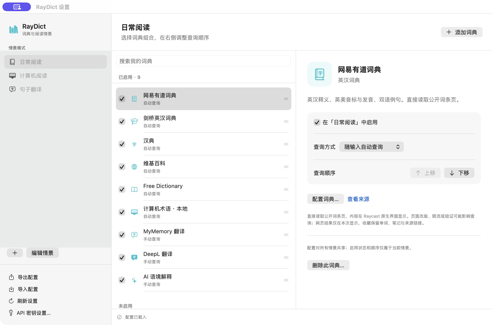

# RayDict

适用于 macOS 和 Raycast 的原生聚合词典。多词典并行查词，配有独立的 SwiftUI 设置窗口、情景模式、生词本和 AnkiConnect 接入，无需浏览器即可使用。

当前版本 **0.4.0**，代码采用 [MIT 许可证](LICENSE)。第三方词典内容保留各自的权利与许可。本项目独立于 Raycast 和各词典服务，也未使用 Saladict 的代码、Logo 或名称作为项目资产。



## 功能

- **14 种内置来源**：有道、剑桥、汉典、维基百科、必应、海词、牛津、朗文、英语维基词典、Free Dictionary、本地术语、MyMemory、DeepL 和 Raycast AI；另支持自定义 JSON API。
- **多词典并行查询**：原生双栏结果，按情景启停、排序，翻译与 AI 默认手动触发。
- **词条选择**：百科消歧列表；有道、维基词典明确标注的原形；牛津、海词提供的拼写候选。选择只更新当前词典，并可返回原查询。
- **取词与剪贴板查词**：选区读取、微信复制菜单兼容路径，以及先确认文字再提交的剪贴板入口。
- **独立设置与记录**：SwiftUI 设置窗口，配置导入导出，查词历史、生词本、笔记与 AnkiConnect 制卡。
- **长期本地使用**：一次性优化构建，命令完成后退出，不依赖持续运行开发终端。

## 安装

需要 **macOS 13+、Raycast、Node.js 22.22.2+、npm 和 Apple Command Line Tools**。支持 Apple Silicon；Intel Mac 可在本机从源码编译，尚未实机验证。

仓库提供完整源码，不提交预编译设置程序。若没有 Apple Command Line Tools，请先安装：

```sh
xcode-select --install
```

下载源码或克隆仓库：

```sh
git clone https://github.com/banyzl/RayDict.git
cd RayDict
npm ci
```

在 Raycast 中运行 **Import Extension**，选择这个含有 `package.json` 的 `RayDict` 文件夹，然后在项目目录执行：

```sh
npm run install:local
```

构建会生成原生设置程序，并将优化后的扩展安装到 Raycast 的本地扩展目录。完成后，在 Raycast 搜索 **RayDict** 即可使用。如果此前运行过开发模式，请在 **Manage Extensions → RayDict → Actions → Stop Development** 停止监听。

这仍是导入的本地扩展，没有 Raycast Store 自动更新。停止开发监听可移除根搜索中的 Development 分组，部分位置仍可能显示本地身份标记。详见[本地使用与更新](docs/LOCAL-USE.md)。

### 更新

在这个克隆目录中执行；如果有自己的源码修改，请先提交或备份：

```sh
git pull --ff-only
npm ci
npm run update:local
```

`update:local` 只构建、安装当前源码；下载远端更新由 `git pull` 完成。扩展标识 `raydict-native`、原有 9 个命令和偏好字段保持不变。

## 使用

在 Raycast 搜索「查词 / Search」，输入单词或句子。常用快捷键：

| 快捷键 | 操作 |
| --- | --- |
| ⌘M | 打开独立设置窗口 |
| ⌘P | 切换情景 |
| ⌘S | 收藏到生词本 |
| ⌘J | 有可选词形时，打开候选列表 |
| ⌘⇧V | 打开剪贴板确认页 |
| ⌘K | 查看当前词典的更多操作 |

只有候选、尚无释义时，按回车选择词条；已有释义时，回车保留复制结果的行为。微信聊天文字若无法直接取得，请先复制，再运行「剪贴板查词」。

完整命令、词典与 API 配置、取词说明见[使用指南](docs/USAGE.md)。

## 开发与验证

```sh
npm ci
npm run check        # 类型检查、44 项测试、代码检查、优化构建、原生自检
npm run dev          # 开发监听；结束后停止 Development
npm run build        # 仅生成 dist/，不刷新本机已安装扩展
npm run test:native  # 构建并验证原生设置与剪贴板保护逻辑
npm run smoke        # 真实网络查询，受各服务可用性影响
```

首次构建会编译 `native-settings/`，无需提交生成的 `.app`、词典目录或 `dist/`。`raycast-env.d.ts` 保留在仓库中，以支持首次构建前的类型检查；修改扩展清单后由 Raycast CLI 重新生成。

GitHub Actions 在每次推送和拉取请求中运行 macOS 完整检查；外部词典的真实网络查询不作为自动检查的通过条件。

## 项目结构

| 路径 | 内容 |
| --- | --- |
| `src/core/` | 查询调度、配置、缓存、数据结构与 Anki |
| `src/providers/` | 内置词典与自定义 API |
| `src/ui/` | Raycast 查询、候选与管理界面 |
| `src/storage/` | 配置、生词本、历史的本地保存 |
| `native-settings/` | SwiftUI 设置窗口与兼容取词 |
| `scripts/` | 构建、原生自检和网络检查 |
| `tests/` | 自动测试 |
| `assets/` | 图标；构建时生成设置程序与目录 |
| `docs/` | 使用、架构、接入与版本验证记录 |
| `examples/` | 不含密钥的自定义 API 示例 |

## 已知限制与数据

微信是否支持直接取词取决于其选区、菜单及辅助功能权限；不能保证所有聊天消息都可单步取词，也没有 OCR 入口。网页词典改版、验证或限流可能影响查询。维基百科在 0.4 验证期间间歇返回 HTTP 503，完整线上消歧流程未能稳定复查，保留重试及原站入口。

在线服务会收到查询文字，支持上下文的翻译、AI 或自定义 API 也会收到用户提供的上下文。密钥请放在 Raycast 的密码偏好设置中；本地历史与生词 JSON 未额外加密。用户的密钥、配置、历史与生词本不在本仓库中。Anki 需要本机 AnkiConnect，用户自己的牌组尚未实机验证。

## 文档

- [使用指南](docs/USAGE.md) · [本地安装与更新](docs/LOCAL-USE.md)
- [Provider 接入](docs/PROVIDERS.md) · [架构与路线](docs/ARCHITECTURE.md)
- [0.4 词条选择与验证](docs/UPDATE-0.4.md) · [0.3 微信取词与词典](docs/UPDATE-0.3.md)
- [版本记录](CHANGELOG.md) · [历史文档索引](docs/README.md)
