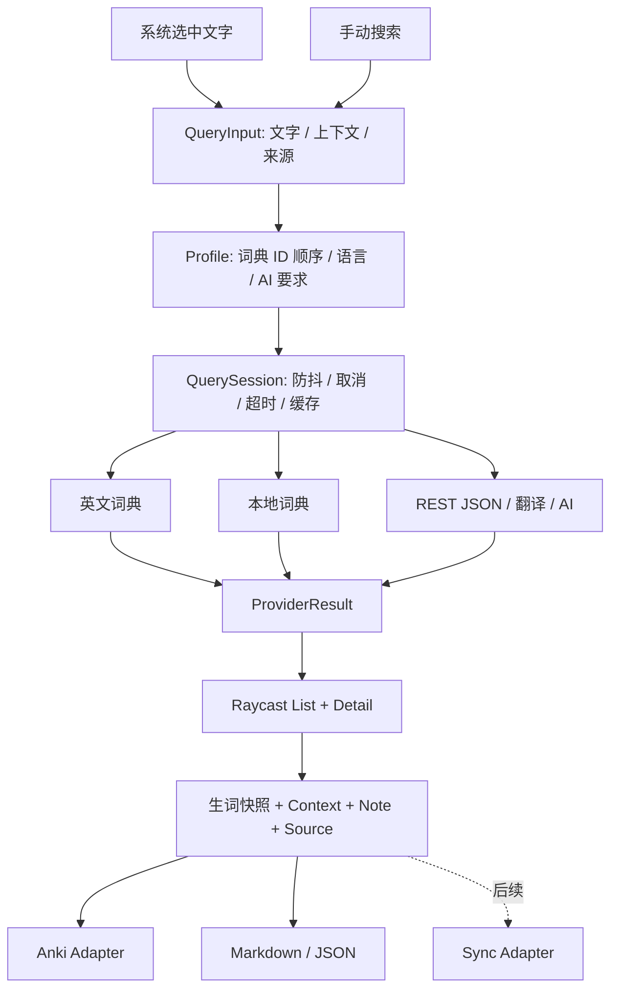

# 项目架构与迭代路线

> 历史记录：以下为对应版本在验证机上的调查与验证；当前源码安装步骤见[项目首页](../README.md)。

v0.2 的原生设置窗口、共享配置文件和迁移说明见 [UPDATE-0.2.md](UPDATE-0.2.md)。下文的初版架构仍适用于查询与学习工作流。

## 数据流

## 目录与职责

| 目录 | 职责 |
| --- | --- |
| `src/*.tsx` | 5 个 Raycast 命令入口，仅组装界面和系统选词 |
| `src/core/schema.ts` | Provider / Profile 配置验证，统一结果和记录类型 |
| `src/core/query.ts` | 无 Raycast 依赖的查询调度、状态、取消和缓存 |
| `src/core/http.ts` | 超时信号、HTTP/JSON 错误、响应体上限、URL 协议限制 |
| `src/core/render.ts` | 统一 Markdown、Anki HTML、来源保留与转义 |
| `src/core/anki.ts` | 独立 AnkiConnect 集成，不依赖查询 UI |
| `src/core/audio.ts` | 有大小/时间限制的音频下载、临时文件和系统播放 |
| `src/providers/` | 数据获取和解析；`registry.ts` 是编译期注册入口 |
| `src/storage/` | Raycast 配置适配、supportPath 原子记录文件 |
| `src/ui/` | 搜索、Provider/Profile 表单、历史和生词本 |
| `tests/` | 查询竞态、数据映射、HTTP、持久化和 Anki 集成测试 |
| `examples/` | 自定义 JSON Provider 配置 |

## 核心约定

`QueryInput` 携带 `text/context/sourceApp/sourceUrl`。Provider 必须返回统一 `ProviderResult`：摘要、词条数组、音标、义项/词性/例句、音频、翻译或 AI 解释，以及来源说明。UI 不认识某个词典的私有响应格式。

全局 Provider 配置描述“怎样查询”。Profile 的 `providerIds` 描述“当前启用哪些词典及其顺序”，同时保存源/目标语言和 AI 提示要求。相同 Provider 可以在不同模式出现；修改其 API 配置会影响所有模式，排序及启停只影响当前模式。

Provider 类型与能力通过内置 Adapter 表达。复杂 Provider 是随扩展一起编译的 TypeScript，不是在运行时执行用户下载的 JS。新增接口需要在配置类型及 registry 中显式登记，保证打包和类型检查能看见依赖。v0.1 尚无动态插件市场和不受限的第三方代码执行机制。

## 查询正确性

- 输入变化后立即废弃旧界面结果，再等待 400 ms 开始自动查询。
- Profile 中的 Provider 并行启动，各自提交结果；显示顺序始终遵循 Profile，不因响应先后跳动。
- 每个 Provider 有独立超时。即使实现忘记响应 AbortSignal，调度层仍会停止等待并显示超时。
- 新输入、切换模式、更新词典或退出视图会取消旧 session；晚到结果不会覆盖新查询。
- 手动 Provider 不随输入触发。词语限定 Provider 对长句显示“不适用”。
- 缓存按查询、上下文、Profile 和配置区分，最多 100 个成功结果，5 分钟过期；只在当前搜索界面内存中存在。
- 无自动重试付费请求；用户可以显式重新查询。

## 持久化与扩展

配置有 `schemaVersion: 1`；当前不支持的版本或无效引用会报错并保留原数据。配置导入会验证全部 Provider，且不会导入本机密码。历史仅保留查询和上下文，限制 300 条；收藏保留成功 Provider 的当时快照与出处。收藏逐条保存，独立写入采用临时文件 + rename，避免多个不同收藏覆盖同一数组。相同记录的同时编辑仍是最后写入者生效，尚无跨进程冲突合并。

未来同步应只同步公开配置和学习记录，排除密钥与内存缓存。建议采用独立 `SyncAdapter`：`pull(cursor)` / `push(changes)`，统一 revision、deviceId、updatedAt 和 tombstone；以记录 UUID 合并，冲突生成副本，先做手动同步，再加入后台任务。WebDAV 应用 ETag + If-Match，保留备份，明确端到端加密策略之后再提供自动同步。v0.1 没有空壳同步按钮，也不声称已完成同步。

## 路线

| 阶段 | 交付与验收 |
| --- | --- |
| v0.1，本次 MVP | 原生双栏、系统选词、并行查询、表单添加 REST API、Profiles、历史/收藏/笔记/来源、发音、可选翻译/AI、Anki、导出 |
| v0.2，数据源 | 逐个评估并接入合法的英汉词典/本地词库；Provider 可用性诊断、完整许可证注册表、语言/长度/领域条件规则 |
| v0.3，学习工作流 | 自动/英美发音偏好、上下文翻译分区、可配置 Anki 模板与 Cloze、媒体导入、批量操作、JSON 记录恢复 |
| v0.4，同步 | 版本迁移、增量日志和删除标记、WebDAV 手动同步、冲突恢复、凭据隔离、可选加密，再提供后台同步 |
| 后续，生态 | Provider 配置分享与验证工具；可替换的 AI 服务 Adapter；可选应用特定的上下文采集器 |

默认不规划浏览器 DOM 划词浮窗与网页全文翻译。自动获取周围上下文只能对有明确可访问接口的应用逐个实现，不能将系统选词当成万能抓取接口。
